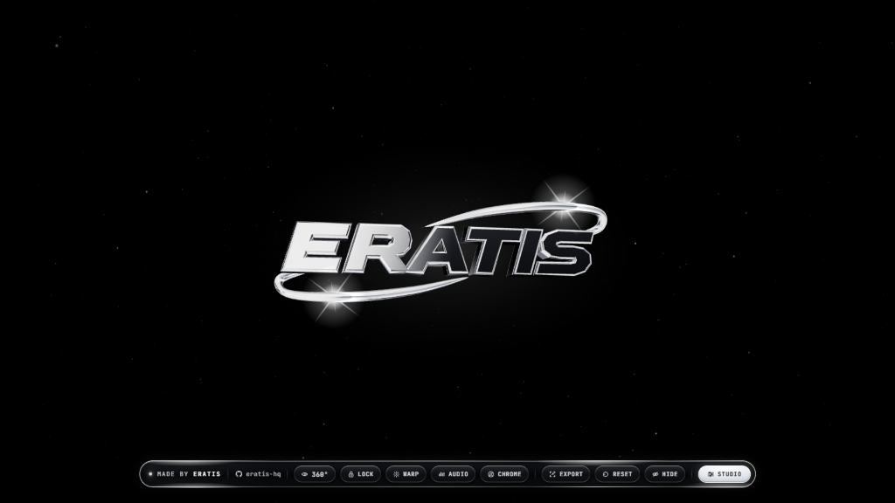
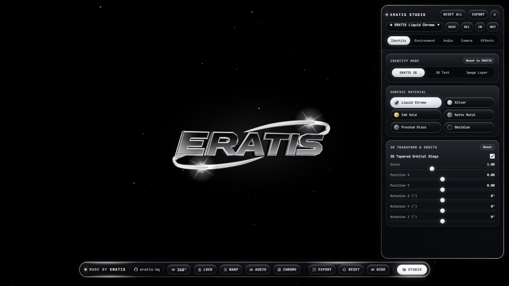

# ERATIS Studio

**ERATIS — Interactive 3D Identity Studio** is an open-source, zero-bundler 3D identity showcase, customizer, and real-time Web Audio visualizer built with vanilla ES6 Modules and **Three.js r128**.

Create metallic 3D typography or flat alpha-preserving logo compositions inside a monochrome deep-space environment, drive lighting and motion with live FFT audio analysis, save validated scene presets, and export up to 4K wallpapers, transparent PNGs, or 60 FPS WebM video captures directly in the browser.



---

## Features

- **Sculpted 3D ERATIS Emblem**: Default slanted, extruded, and beveled 3D letterforms surrounded by tapered 3D orbital crescent rings (`CatmullRomCurve3`) and dual 4-point starburst flares.
- **Procedural Studio Environment & 6 PBR Materials**: Generates an in-memory `2048x1024` monochrome studio equirectangular reflection map (`EquirectangularReflectionMapping`) with no external HDRI files required. Switch between **Liquid Chrome**, **Silver**, **24K Gold**, **Matte Metal**, **Frosted Glass**, and **Obsidian**.
- **Custom 3D Typography & Multilingual Font Engine**: Extrude custom text in real time across 16 built-in fonts or uploaded `.ttf`, `.otf`, `.woff`, and `.typeface.json` files with exact Non-Zero Winding contour resolution, real `kern`/`GPOS` kerning, adaptive safe beveling, and style-matched Unicode fallback (`Noto Sans` / `Noto Serif`) supporting Latin, Cyrillic, Greek, and extended Unicode scripts.
- **Flat Alpha-Preserving Image Layer**: Upload `PNG`, `JPG`, `WebP`, or `SVG` artwork rendered on a clean `PlaneGeometry` that preserves original aspect ratio and transparency.
- **Calligraphic Signature Pen-Draw Intro**: Animates `public/assets/eratis-signature.svg` stroke-by-stroke at 60 FPS on launch, with support for uploading custom sanitized `.svg` signatures or skipping at any time.
- **Real-Time Web Audio Engine (`fftSize = 2048`)**: Full local playlist player with live 3-band FFT analysis (`Bass`, `Mid`, `Treble`) driving reflections, orbital ring scale, starfield motion, flares, and studio lights.
- **Presets & Local Persistence**: 5 built-in presets, custom preset management in `localStorage`, automatic session state restore, and schema-validated JSON import/export.
- **Wallpaper & Export Studio**: Export `4K UHD`, `16:9 HD`, `21:9 Ultrawide`, `9:16 Mobile`, `1:1 Square`, and `2560x1440` transparent Alpha PNGs, Scene JSON backups, and 60 FPS WebM video recordings with automatic Web Audio muxing.

---

## 3D Experience

ERATIS Studio renders inside a full-viewport WebGL canvas configured with `ACESFilmicToneMapping`, `sRGBEncoding`, and alpha buffer support for transparent exports:

- **Lighting Rig**: Combines an ambient fill, directional key light, directional silver rim light, secondary fill point light, and a cursor-tracking specular point light whose intensity responds to audio mid/treble energy.
- **Deep-Space Atmosphere**: Pure obsidian `#000000` void (customizable to any hex color), exponential distance fog (`THREE.FogExp2`), a subtle backlight halo behind the emblem, radial edge vignetting, and a monochrome starfield (200 to 4,800 particles; default 2,400) with Warp Hyperdrive acceleration.
- **Camera & Motion Physics**: Distant cinematic framing (`z = 25.5`, `FOV = 38°`) with inertial drag-to-rotate physics, scroll zoom, cursor parallax, subtle idle floating sway, continuous `360°` auto-orbit, and a `LOCK` static pose mode that freezes sway and cursor drift for exact framing.
- **WebGL Context Recovery**: Automatically pauses and displays a recovery overlay on `webglcontextlost`, then resynchronizes scene state and resumes rendering upon `webglcontextrestored`.

---

## Studio Mode & Customization

Click **STUDIO** on the bottom control dock (or press `S`) to open the 5-tab editing panel.



### Identity Tab

Choose between three identity modes and adjust global 3D placement (`Scale`, `Position X/Y`, `Rotation X/Y/Z`) and orbital ring visibility:

1. **ERATIS 3D**: The signature sculpted ERATIS emblem. Return to it in one click from either the Studio panel or the dock's `ERATIS` button whenever another mode is active.
2. **3D Text**: Real-time extruded and beveled multilingual typography (`THREE.ExtrudeGeometry` with Non-Zero Winding contour resolution, real `kern`/`GPOS` kerning, adaptive safe beveling, and pan-Unicode fallback).
   - **16 Built-in Fonts**: `Helvetiker`, `Optimer`, `Gentilis`, `Droid Sans`, and `Droid Serif` (Bold and Regular) plus `Orbitron Sci-Fi`, `Cinzel Roman`, `Montserrat Display`, `Syne Avant-Garde`, `Audiowide Cyber`, and `Michroma Aerospace`.
   - **Custom Fonts**: Click `+ ADD` (or drag and drop onto the window) to load `.ttf`, `.otf`, `.woff`, or Three.js `.typeface.json` fonts parsed client-side with `opentype.js`. Unused fonts can be removed with `DEL` (at least one font always remains) and deleted built-ins can be restored in one click.
   - **Geometry Controls**: Live sliders for `Letter Spacing`, `Italic Slant` (4x4 shear matrix), `Extrude Depth`, `Bevel Size`, and `Bevel Thickness`.
3. **Image Layer**: Displays `PNG`, `JPG`/`JPEG`, `WebP`, or high-DPI rasterized `SVG` files (up to `2048px`) on a flat plane preserving exact aspect ratio and alpha channel, with `Layer Opacity` and `Layer Scale` sliders.

### Environment, Camera & Effects Tabs

| Tab | Available Controls |
| :--- | :--- |
| **Environment** | Void background hex color (with one-click `#000000` reset), tone exposure, chrome reflection multiplier, key/rim/cursor light intensities, exponential fog density, and starfield enable, count (`200–4800`), drift speed, size, and brightness. |
| **Camera** | Camera distance (`11–42`), field of view (`22°–70°`), cursor parallax strength, Static Pose Lock (`L`), `360°` continuous auto-orbit (`O`), orbit speed, and idle floating sway. |
| **Effects** | Warp Hyperdrive toggle and intensity, 4-point orbital lens flares toggle and scale, obsidian edge vignette strength, Signature Intro replay/custom `.svg` upload/reset, and keyboard shortcut reference. |

### Bottom Control Dock

The unified bottom dock provides immediate access to core controls without opening Studio Mode:

```text
MADE BY ERATIS | eratis-hq | 360° | LOCK | WARP | AUDIO | CHROME | EXPORT | RESET | HIDE | STUDIO
```

Hovering over any dock button (or tapping on touch devices) opens a quick-action popover menu for selecting orbit speeds, warp levels, material finishes, audio transport actions, quick wallpaper exports, or jumping straight to a specific Studio tab. On viewports `<= 1020px`, secondary controls collapse into a compact `...` menu while keeping `STUDIO` accessible.

### Global Drag & Drop

Drop supported files anywhere on the viewport to load them immediately:

- **Audio**: `.mp3`, `.wav`, `.ogg`, `.flac`, `.m4a`, `.aac`, `.webm`, `.opus`
- **3D Fonts**: `.ttf`, `.otf`, `.woff`, `.typeface.json`
- **Images**: `.png`, `.jpg`, `.jpeg`, `.webp`, `.svg`
- **Presets**: `.json` (validated ERATIS Studio scene files)

---

## Audio Engine & Reactivity

The audio system is implemented directly on the browser's **Web Audio API** (`AudioContext` + `AnalyserNode` with `fftSize = 2048` and `smoothingTimeConstant = 0.8`). No synthetic sine-wave animations are substituted when no audio is playing; all bands decay smoothly to `0` when playback pauses or stops.

| Frequency Band | Range | 3D Scene Targets |
| :--- | :--- | :--- |
| **Bass** | `20 – 150 Hz` | Active material reflection intensity (`envMapIntensity`) and orbital ring scale |
| **Mid** | `150 – 2,500 Hz` | Starfield drift speed, key light intensity, cursor light intensity, and lens flare scale |
| **Treble** | `2,500 – 12,000 Hz` | Starfield speed, star size and brightness, rim light, cursor light, and lens flare scale |

The **Audio** tab includes live percentage meters for all three bands, multi-file playlist management, play/pause, previous/next, timeline scrubbing, volume and mute controls, shuffle, repeat (`off`, `all`, `one`), an audio reactivity toggle, and independent sensitivity sliders for `Bass` and `Mid/Treble`.

---

## Presets & Storage

ERATIS Studio ships with 5 built-in presets:

- **ERATIS Liquid Chrome** (default)
- **24K Solar Gold**
- **Obsidian Stealth**
- **Frosted Nebula**
- **Hyperdrive Silver**

### Persistence & Privacy

- **Automatic Session Persistence**: Active scene parameters are saved to `localStorage` (`eratis_studio_active_state_v1`) and restored on subsequent visits.
- **Custom Presets**: Save, overwrite by name, apply, or delete custom presets stored under `eratis_studio_custom_presets_v1`. Built-in presets are protected from deletion.
- **Validated JSON Import/Export**: Every imported JSON file is validated against the ERATIS schema (`app: "eratis-studio"`, allowed enum values, `#RRGGBB` hex colors, and clamped numeric ranges). Invalid files are rejected with clear error messages.
- **Local Media Exclusion**: For privacy and portability, local audio tracks, uploaded images, and custom SVG signature files are never serialized into `localStorage` or exported `.json` files. If a restored session was in `image` mode, the studio cleanly resets to `eratis` mode on reload.

---

## Export Studio

Open **EXPORT** from the bottom dock or Studio header to capture still renders, scene backups, or live video:

| Export Option | Resolution / Format | Notes |
| :--- | :--- | :--- |
| **4K Cinema Wallpaper** | `3840 x 2160` PNG (`16:9`) | Full scene with optional Cinema finishing |
| **16:9 Desktop Wallpaper** | `1920 x 1080` PNG (`16:9`) | Widescreen desktop capture |
| **21:9 Ultrawide Cinema** | `3440 x 1440` PNG (`21:9`) | Panoramic monitor capture |
| **9:16 Phone Lockscreen** | `1080 x 1920` PNG (`9:16`) | Vertical mobile wallpaper |
| **1:1 Profile / Cover Art** | `2048 x 2048` PNG (`1:1`) | Centered square avatar or cover art |
| **Transparent 3D Logo** | `2560 x 1440` Alpha PNG | Isolated 3D emblem without stars, fog, or backlight |
| **Scene JSON** | `.json` | Schema-validated configuration backup |
| **WebM Video Capture** | `60 FPS` `.webm` (`8 Mbps`) | Live `canvas.captureStream(60)` + `MediaRecorder` with automatic Web Audio muxing |

Opaque wallpaper exports support two toggleable finishing options: **Cinema Specular Bloom & Vignette** (screen-blended optical bloom and baked radial vignette) and an optional **Corner ERATIS Signature Tag** (`ERATIS STUDIO · @ERATIS-HQ`).

---

## Getting Started

ERATIS Studio has no build step and requires no npm package installation to run.

### Requirements

- A modern desktop browser with **WebGL** and **Web Audio API** support (Chrome, Edge, Firefox, or Safari).
- An active internet connection for CDN-hosted runtime libraries (`Three.js r128`, `opentype.js 1.3.4`, `JetBrains Mono`) and built-in 3D font files.
- **Node.js `>= 18.0.0`** (optional, for `npm start` and running the unit test suite).

### Run Locally

Clone the repository and serve the project directory over HTTP:

```bash
git clone https://github.com/eratis-hq/eratis-studio.git
cd eratis-studio

# Option 1: Using the package.json start script (Node.js / npx)
npm start

# Option 2: Using Python 3
python -m http.server 3000
```

Open `http://localhost:3000` in your browser.

> **Note:** `index.html` also includes a `file://` compatibility fallback script for opening the file directly without a server, but serving over `http://localhost` is recommended so native ES6 modules (`src/main.js`) and external asset fetches run without local file restrictions.

### Run Tests

Automated unit tests cover configuration defaults, reactive store updates, Web Audio FFT bin math and decay curves, preset schema validation and privacy stripping, and SVG signature sanitization:

```bash
npm test
```

### Production Deployment

Because the project uses static HTML, CSS, and native ES6 Modules with no bundler, there is no build command. Deploy the repository root directly to any static host (such as GitHub Pages, Cloudflare Pages, Netlify, or Vercel).

---

## Controls

### Keyboard Shortcuts

| Key | Action |
| :--- | :--- |
| `Space` | Play / Pause audio (or toggle Warp Hyperdrive if playlist is empty) |
| `S` | Toggle Studio Mode panel |
| `O` | Toggle `360°` continuous auto-orbit |
| `L` | Toggle Static Pose Lock (freezes sway and cursor parallax) |
| `W` | Toggle Warp Hyperdrive |
| `H` | Toggle Cinema Zen Mode (hide / show UI) |
| `R` | Factory reset all settings and camera orientation |
| `Left` / `Right` | Previous / Next track in audio playlist |
| `Esc` | Skip Signature Intro, exit Zen Mode, or close active modal / panel |

### Mouse & Touch

| Input | Action |
| :--- | :--- |
| **Drag** | Rotate the 3D scene with inertial momentum |
| **Scroll Wheel** | Zoom camera distance (`z = 11` to `42`) |
| **Double-Click Canvas** | Reset camera angle and distance |
| **Click Default ERATIS Logo** | Open the `@eratis-hq` GitHub profile |
| **Hover / Tap Dock Buttons** | Open quick-action popover controls |

---

## Tech Stack

- **3D Rendering**: [Three.js r128](https://threejs.org/) (`WebGLRenderer`, `ExtrudeGeometry`, `Shape`, `CatmullRomCurve3`, `MeshStandardMaterial`, `MeshPhysicalMaterial`, `CanvasTexture`)
- **Client-Side Font Parsing**: [opentype.js 1.3.4](https://opentype.js.org/) for reading `.ttf`, `.otf`, and `.woff` outlines, metrics, and `kern`/`GPOS` kerning tables
- **Audio Analysis**: Native browser **Web Audio API** (`AudioContext`, `AnalyserNode`, `MediaElementAudioSourceNode`, `MediaStreamAudioDestinationNode`)
- **Video Capture**: Native `HTMLCanvasElement.captureStream()` and `MediaRecorder` API
- **Application Architecture**: Vanilla ES6 Modules, HTML5, and CSS3 (zero bundler, zero runtime npm dependencies)
- **Testing**: Built-in Node.js test runner (`node --test`)

---

## Project Structure

```text
eratis-studio/
├── index.html                        # Entry HTML, CDN scripts, hidden file inputs, file:// fallback
├── package.json                      # Package metadata, npm start and npm test scripts
├── README.md                         # Project documentation
├── LICENSE                           # MIT License
├── public/
│   ├── assets/
│   │   └── eratis-signature.svg      # Default calligraphic brush-ink intro signature SVG
│   └── screenshots/
│       ├── eratis-studio-main.png    # Main 3D viewport & bottom dock screenshot
│       └── eratis-studio-panel.png   # Studio Mode customization panel screenshot
├── src/
│   ├── main.js                       # App bootstrap, file inputs, drag-and-drop, keyboard shortcuts
│   ├── core/
│   │   ├── config.js                 # Defaults, 6 PBR materials, 16 built-in fonts, 5 presets
│   │   └── state.js                  # Reactive deep-merge state store
│   ├── scene/
│   │   ├── engine.js                 # WebGL loop, lighting, camera physics, snapshot compositor
│   │   ├── eratisLogo.js             # Sculpted 3D ERATIS letterforms, tapered orbits, flares
│   │   ├── materials.js              # Procedural 2048x1024 studio envMap & PBR MaterialManager
│   │   ├── textBuilder.js            # Multilingual 3D font engine, planar union, kerning & fallback
│   │   ├── imageLayer.js             # Alpha- and aspect-preserving flat media plane
│   │   └── starfield.js              # Monochrome deep-space particle field
│   ├── audio/
│   │   └── audioEngine.js            # Web Audio API playlist player & 3-band FFT analyzer
│   ├── studio/
│   │   └── studioPanel.js            # 5-tab Studio Mode panel and live spectrum meters
│   ├── presets/
│   │   └── presetManager.js          # localStorage persistence & schema-validated JSON I/O
│   ├── export/
│   │   └── exportStudio.js           # Wallpaper/PNG exports, JSON download, 60 FPS WebM recorder
│   └── ui/
│       ├── signatureIntro.js         # 60 FPS SVG stroke pen-draw intro & XSS sanitizer
│       ├── dock.js                   # Bottom control dock, hover popovers, Cinema Zen Mode
│       └── styles.css                # Obsidian & liquid-chrome pill UI design system
└── tests/
    └── studio.test.js                # Unit and integration tests (node --test)
```

---

## Limitations

- **External CDN Dependency**: `Three.js r128`, `opentype.js 1.3.4`, `JetBrains Mono`, and built-in 3D font files are loaded from external CDNs (`cdnjs`, `jsDelivr`, `unpkg`, Google Fonts). Offline usage is not supported without local copies.
- **Session-Only Local Media**: Uploaded audio files, custom images, custom uploaded fonts, and custom SVG signatures remain in browser memory for the current session only and are not saved across page reloads or embedded inside exported JSON presets.
- **WebM Video Recording Compatibility**: 60 FPS WebM export relies on `MediaRecorder` and `canvas.captureStream()`, which are primarily supported in Chromium-based browsers and Firefox. Safari and older browsers may not support WebM recording codecs; the UI detects this and disables recording with a status notice.
- **Single-Line Text Input in UI**: While `TextBuilder` supports up to 3 lines internally, the Studio Mode text field is a single-line input (`maxlength="36"`).
- **Touch Zoom**: Pointer drag rotation and tap popovers work on touch screens, but multi-touch pinch-to-zoom is not implemented separately (use the Camera distance slider in Studio Mode).

---

## Contributing

Contributions are welcome. Because ERATIS Studio is a zero-bundler ES6 Modules project, changes can be tested immediately with a local static server.

1. Fork the repository and create a feature or fix branch.
2. Make your changes in `src/` and add or update unit tests in `tests/studio.test.js` where applicable.
3. Run `npm test` to verify all tests pass.
4. Test the application locally via `npm start` in a desktop browser.
5. Open a pull request with a concise description of the change.

---

## License

Released under the [MIT License](./LICENSE). Copyright (c) 2026 [ERATIS](https://github.com/eratis-hq).
